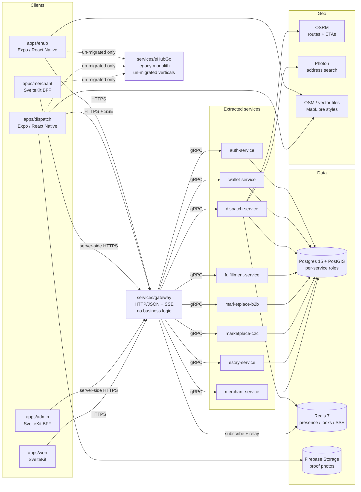
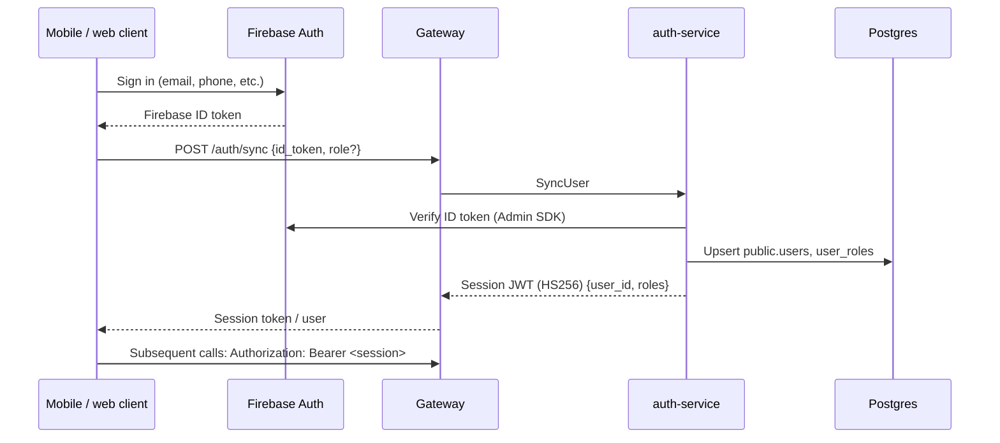
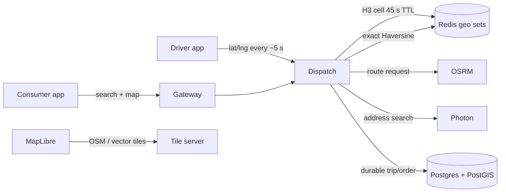
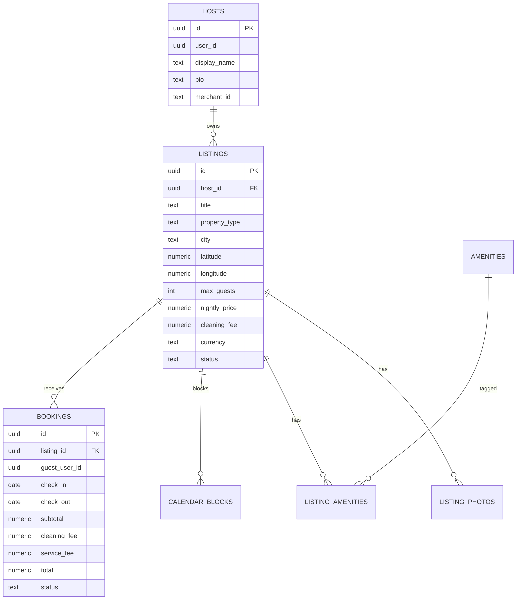
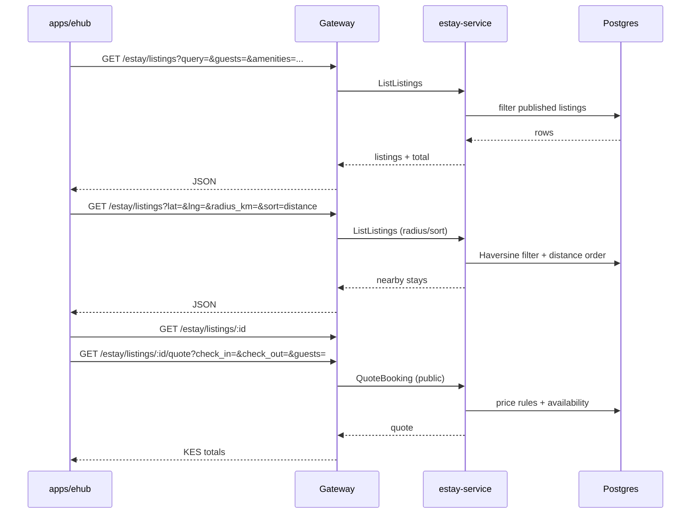
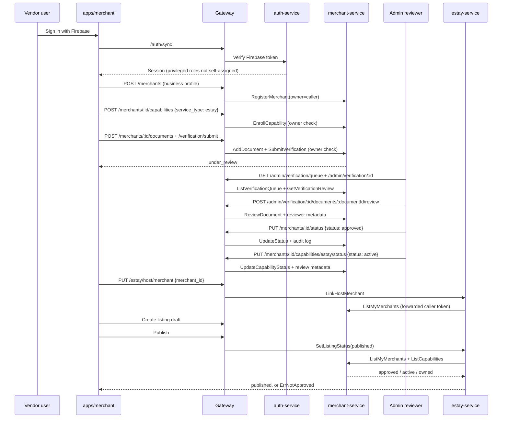

# eHub Platform Architecture

> **Status:** current implementation plus target boundaries, reviewed 2026-11-09.
> The extracted services are real and runnable; the legacy monolith is still
> present for un-migrated verticals. Vendor onboarding now includes URL-backed
> verification documents, an admin review queue, owner-issued store staff
> invitations/roles, and a live merchant/capability approval gate before an
> Estay listing can publish.
> Docker/live-database validation for the latest Estay, catalogue, merchant,
> onboarding and MapLibre work is intentionally deferred to the manual test phase
> (see `TESTING.md`).

eHub is an urban commerce and mobility platform. It combines ride-hailing,
courier delivery, food/grocery ordering, a marketplace, short-stay
accommodation (Estay), and a wallet. The repository is a monorepo of thin
frontends, independent backend services, protobuf contracts and shared
infrastructure.

The design is a **strangler-fig migration**: the legacy Go monolith
(`services/eHubGo`) remains the source of truth for verticals that have not been
extracted, while new domains run as independent services behind a single API
gateway. `services/eHubGo` is reference-only; new work must not add to it.

---

## 1. Design principles

1. **One app-facing backend.** Mobile and web clients call the gateway at
   `/api/v1/gateway`. They do not call service gRPC ports, Postgres, Redis, OSRM
   or Photon directly. The gateway validates the session, applies public rate
   limits, and forwards calls over gRPC.
2. **The gateway owns transport, not business rules.** Pricing, booking
   conflicts, fare rules, verification and ownership checks belong to the
   owning service. The gateway must not become a second domain implementation.
3. **One domain, one writer.** Each extracted service owns its tables or schema
   and connects with its own least-privilege Postgres role. Cross-service reads
   go through APIs/gRPC, not SQL joins.
4. **Contracts first.** Protobuf definitions in `proto/` are the service
   contracts. Go bindings live in `packages/proto`; the gateway and services share
   them.
5. **Server-authoritative money and availability.** Clients may request a quote,
   but the service computes the price and the database enforces non-overlap.
6. **Stateless processes, explicit state.** Services are disposable processes;
   durable state is Postgres, live presence is Redis, objects are external
   storage, and maps are OSM/MapLibre.
7. **Graceful fallbacks where the domain allows it.** OSRM can fall back to a
   straight line; MapLibre can fall back to an OSM raster style; Redis
   rate-limit/surge failures fail open rather than block a booking.
8. **Least privilege by default.** Development credentials are not secrets, but
   production roles/passwords must be rotated and the superuser URL is reserved
   for migrations and the monolith.

---

## 2. System context



The dashed legacy path is migration debt: some consumer screens still call the
Render-hosted monolith through `EXPO_PUBLIC_API_URL`. Extracted domains
(auth, wallet, dispatch, marketplace, Estay, merchant) must use the gateway.

---

## 3. Request and authentication flow

### 3.1 Session creation



The session JWT is issued once and validated independently by every service. The
Go services share `packages/platform/auth`; the NestJS C2C service mirrors the
same rules in its guard. The gateway forwards the caller's token over gRPC
metadata so each service re-checks it (defence in depth), rather than trusting a
`user_id` supplied in a request body.

`/auth/sync` only self-assigns the customer/participant roles. `admin`,
`executive_admin`, `staff` and `store_staff` are operational roles and must be
granted outside the sync request.

Public RPCs are explicitly allow-listed per service. Estay's public set is
amenities, published-listing search/detail, availability, and the booking quote
preview. Booking creation and all host operations require a session. Merchant's
public set is only `GetMerchant`; the gateway sanitizes that response and the
gRPC interceptor requires a token for every other RPC.

### 3.2 Typical gateway call

```mermaid
sequenceDiagram
  participant App as Client
  participant GW as Gateway
  participant Svc as Owning service
  participant DB as Postgres

  App->>GW: GET /api/v1/gateway/<domain>/...
  GW->>GW: Public rate-limit check (Redis)
  GW->>GW: Parse params / bind protobuf request
  GW->>Svc: gRPC method + authorization metadata
  Svc->>Svc: Validate JWT; derive caller identity
  Svc->>DB: Query/write with the service's own role
  DB-->>Svc: Rows
  Svc-->>GW: Protobuf response
  GW-->>App: JSON (protojson)
```

The gateway also relays dispatch's Redis Pub/Sub streams as SSE:

- `GET /dispatch/driver/stream` for a driver's offers;
- `GET /dispatch/trips/:id/locations` for an authorized trip participant.

SSE routes accept `?token=` because `EventSource` cannot set headers. That is a
known logging/privacy trade-off; native clients use the bearer header where
possible.

---

## 4. Service ownership, ports and responsibilities

### 4.1 Process map

| Service | HTTP | gRPC | Database role / schema | Owns |
|---|---:|---:|---|---|
| `eHubGo` (legacy) | 9000 | - | `user` (owner), `public` | Un-migrated verticals; legacy `properties`, legacy taxi/orders paths; not part of new work |
| `auth-service` | 9001 | 9101 | `ehub_auth` / `public` | `users`, `user_roles`; Firebase verification and session issuance |
| `wallet-service` | 9002 | 9102 | `ehub_wallet` / `wallet` | Wallet accounts, transactions, balanced ledger, M-Pesa integration |
| `dispatch-service` | 9003 | 9103 | `ehub_dispatch` / `public` | Driver availability/location, H3 discovery, ride and delivery lifecycles, fares, offers, ratings, proof-of-handover |
| `fulfillment-service` | 9004 | 9104 | `ehub_fulfillment` / `public` | Order fulfillment state machine and driver assignment |
| `marketplace-b2b` | 9005 | 9105 | `ehub_b2b` / `public` | Read-only catalogue, taxonomy, brands/models, scheduled pricing refresh |
| `marketplace-c2c` | 9006 | 9106 | `ehub_c2c` / `public` | Peer-to-peer seller listings and RLS policies |
| `estay-service` | 9007 | 9107 | `ehub_estay` / `estay` | Hosts, listings, photos, amenities, calendar, availability, quotes, bookings, host-to-merchant link, live publish gate |
| `merchant-service` | 9008 | 9108 | `ehub_merchant` / `public` | Merchant registry, capabilities, verification documents/status/audit, admin review queue, capability review, owner-issued staff invitations/roles and scoped staff access |
| `gateway` | 9010 | - | none | HTTP/JSON BFF, rate limits, aggregation, SSE relay |
| `travel-service`, `accommodation-service`, `lifestyle-service` | - | - | - | Scaffolds; `accommodation-service` is superseded by Estay |

Backend ports follow `9000s = HTTP`, `9100s = gRPC`. Frontends keep their normal
local ports (Expo/Metro `8081+`, SvelteKit/Vite `5173+`).

### 4.2 Blast-radius boundaries

- A failure in Estay does not prevent ride-hailing or wallet use.
- A malformed merchant record cannot corrupt a stay booking.
- Dispatch owns ephemeral driver presence; Estay owns durable accommodation
  inventory.
- The gateway is stateless except for its rate-limit counters and SSE
  subscriptions, all in Redis.

---

## 5. Data architecture and ownership contracts

### 5.1 Shared instance, separate roles

All services currently point at one Postgres instance (local Docker or Neon),
but each uses a distinct login role. Grants are declared in
`infra/db/contracts.sql` and verified in both directions by
`infra/db/verify_contracts.sql`:

- `MISSING`: a promised privilege is absent;
- `EXTRA`: a role holds a privilege outside its contract.

This makes a cross-domain query fail with `permission denied` instead of
silently succeeding. The contract matrix and change procedure live in
`infra/db/OWNERSHIP.md`.

```
             ┌──────────────────────────────┐
             │          ehub_db             │
             │  public | wallet | estay     │
             └──────────────────────────────┘
                 ▲          ▲          ▲
       ehub_auth │  ehub_estay│ ehub_merchant
                 │          │          │
            auth-service  estay-service  merchant-service
```

### 5.2 Owned domains

| Domain | Storage | Write ownership | Notes |
|---|---|---|---|
| Wallet | `wallet` schema | `wallet-service` | Fully isolated; ledger is the money source of truth |
| Estay | `estay` schema | `estay-service` | Fully isolated; no monolith property tables |
| Delivery/ride telemetry | `deliveries`, `delivery_*`, `ride_declines`, `service_ratings`, `taxi_trips` | `dispatch-service` | Some transitional `public` co-writes remain |
| Merchant registry | `merchants`, `merchant_capabilities`, `merchant_documents`, `merchant_verification_logs`, `merchant_staff` | `merchant-service` | Documents are URL-backed; staff membership is owner-managed and suspended rather than deleted |
| Catalogue | `products`, `categories`, `brands`, `product_models` | Monolith + `SECURITY DEFINER` pricing refresh | B2B is read-only at runtime |
| C2C | `c2c_sellers`, `c2c_listings` | `marketplace-c2c` + monolith | Transitional co-writer |
| Orders | `orders`, `order_items`, `deliveries` | Monolith / fulfillment / dispatch | Status mirroring is a known transitional coupling |

### 5.3 Why a shared database now

The migration intentionally avoids a risky distributed-transaction rewrite.
Schemas and roles create real service boundaries without splitting the physical
instance yet. The long-term path is one database (or schema cluster) per
service, using the same contracts and moving via `pg_dump -n <schema>` or a
managed migration. Cross-service workflows use APIs and eventual consistency,
not distributed SQL transactions.

RLS is present from the monolith era, but extracted service roles currently keep
`BYPASSRLS` deliberately. Dropping it requires finishing the `orders.status`
mirror and other transitional co-writes first.

---

## 6. Geography: H3, PostGIS, OSRM and Photon

eHub uses several geo tools for different jobs. They are not
interchangeable.



### 6.1 H3 for live driver discovery

H3 is a hierarchical, hexagonal geospatial index. Dispatch uses **resolution 9**,
where cells are roughly 200 m across. The flow is:

1. A driver publishes a location; dispatch computes the H3 cell at resolution 9
   and writes the driver into a Redis set keyed by cell, with a **45-second TTL**.
2. A rider requests nearby drivers. Dispatch expands `gridDisk` around the
   rider's cell adaptively (roughly a 1–3 km search) until it finds enough
   candidates.
3. Redis returns candidate IDs; dispatch post-filters with exact Haversine
   distance and filters by vehicle class/capacity/availability.
4. The trip request re-checks everything under a database row lock and a Redis
   `SET NX EX` accept mutex.

Why H3 here rather than a PostGIS radius query on every heartbeat?

- Hexagons have uniform neighbour distances, so ring expansion is predictable.
- Live presence is ephemeral and high-write; Redis sets are cheap and
  cross-replica.
- H3 gives a shared key for both discovery and surge demand accounting
  (`dispatch:h3:r9:<cell>`).
- Durable geometry still belongs in PostGIS for trips, orders and long-term
  reporting. H3 is an index for *live* state, not a replacement for PostGIS.

Surge uses the same cells: demand is a Redis counter/set per pickup cell, supply
is the live driver set, the multiplier is `1 + 0.2 × demand/supply` capped at
`1.8`, and it is `1.0` when supply is zero. Demand keys expire after about 20
minutes. Surge lookup fails open with a short timeout, so Redis trouble cannot
block a booking.

### 6.2 PostGIS

PostGIS (`GEOGRAPHY(POINT, 4326)` and spatial functions) stores durable spatial
data such as legacy business/trip locations and geometry used by the monolith
and dispatch. It is the right place for durable distance, containment and
indexing; it is not used as the live presence cache.

Estay currently stores listing latitude/longitude and computes radius/distance
with Haversine in Go, not a PostGIS GiST query. That is correct for the current
listing volume but is a scaling gap: add a generated `geography` column and a
GiST index if stay search grows beyond simple scans.

### 6.3 OSRM

OSRM provides road-network distance, duration and encoded polylines. Dispatch
calls it for:

- ride route previews (`GET /dispatch/route`);
- fare distance/duration when creating rides;
- delivery pickup → dropoff legs;
- driver approach lines in the driver console.

When `OSRM_URL` is absent or unreachable, dispatch falls back to straight-line
distance at an assumed speed. The mobile map then has no road polyline, but
fares and requests still work. This is an explicit availability trade-off, not a
silent success claim: the response exposes the fallback shape.

### 6.4 Photon

Photon provides address/place autocomplete on an OpenStreetMap-derived index.
The apps search places through the gateway, resolve a `place_id` to coordinates,
and only then request routes/fares. This keeps the UX destination-first and
avoids sending a map-provider key to clients. The local stack uses a bounded
Kenya/Nairobi fixture; production needs a full, maintained Photon index.

---

## 7. Estay end to end

Estay is the reference extracted vertical: it has its own schema, its own DB
role, host and guest APIs, server-priced quotes and bookings, and a consumer
mobile flow that no longer uses the monolith.

### 7.1 Domain model



A host is created lazily on the user's first host action and remains scoped to
the **user**. The optional `merchant_id` links that workspace to exactly one
owned vendor store. It is a soft cross-service id because merchant verification
belongs to `merchant-service`; the publish path re-checks it live.

A listing carries address, coordinates, capacity, nightly price/cleaning fee in
KES, min/max nights, instant-book, photos and amenity links. Publishing requires
an address, coordinates, a positive nightly price, at least one absolute-URL
photo, and an approved vendor store with an active eStay capability.

### 7.2 Guest discovery



Supported discovery filters include destination/host text, city/country,
`host_id`, guests, bedrooms, beds, bathrooms, price range, property type, paired
dates, instant-book, repeatable amenity keys, radius, and sort (`distance`,
price ascending/descending, rating). Host-name search and host filtering let the
consumer app open a host profile's stays without a direct database query.

The consumer app (`app/miniservices/ehost.tsx`, `app/listings/stay/[id].tsx`)
uses `estayClient` through the gateway. It supports destination search, “stays
near me,” filters, host shortcuts, a photo carousel, amenities, a MapLibre map,
server quotes and booking. Legacy `/properties/:id` and
`/properties/:id/book` links redirect to `/listings/stay/:id`; they no longer
call the monolith. The merchant app's stay links use the same route.

### 7.3 Quote and booking correctness

- `QuoteBooking` and `CreateBooking` use the same calculation:
  `nightly × nights + cleaning fee + service fee`, with the fee percentage from
  `ESTAY_SERVICE_FEE_PERCENT` (default 5%).
- The quote is public because it is read-only; booking creation is authenticated.
- The client never supplies the total.
- Double-booking is prevented by a GiST exclusion constraint on
  `listing_id` + `daterange(check_in, check_out, '[)')` for pending/confirmed
  rows, plus listing-row locking in the service.
- Host blackout blocks are checked in the same path.
- A reaper completes stays whose check-out has passed.

Booking state machine:

```
pending ──confirm──> confirmed ──checkout──> completed
   │                     │
   ├──decline──> declined
   └──cancel───> cancelled (guest, before check-in)
```

### 7.4 Host workspace

`apps/merchant` is the SvelteKit host workspace. Its browser holds an httpOnly
session cookie; all gateway calls are server-side. It supports host profile,
multiple listings, photos, amenity selection, pricing, calendar blocks and
booking requests. The mobile app also exposes host screens
(`ehost-host.tsx`, `ehost-create.tsx`, `ehost-calendar.tsx`,
`ehost-bookings.tsx`) for the same gateway endpoints.

Host authorization is **session + host ownership + live vendor approval**. Any
authenticated user can lazily become a host and prepare drafts, but a stay can
only be published after the workspace is linked to one of the caller's merchant
stores and that store is approved, active, and enrolled in eStay with an
`active` capability. The Estay service enforces this in
`SetListingStatus`; the browser UI only reflects it. See the next section.

---

## 8. Vendor onboarding and merchant identity

### 8.1 What exists

`merchant-service` owns:

- `merchants` (owner, profile, verification status, rating/review cache);
- `merchant_capabilities` (one row per service type such as `estay`, `efood`,
  `egrocery`, with pending/active/suspended status);
- `merchant_verification_logs` (append-only status audit);
- `merchant_documents` (URL-backed evidence, per-document review metadata);
- `merchant_staff` (one row per invited user, with `manager`, `cashier` or
  `delivery` role, `invited`/`active`/`suspended` status and acceptance time).

Gateway routes:

| Route | Auth | Behaviour |
|---|---|---|
| `POST /merchants` | session | Register a merchant for the caller |
| `GET /merchants/me` | session | List merchants owned by the caller |
| `GET /merchants/:id` | public | Safe storefront profile; the gateway strips `owner_id`, `phone_number` and `email` |
| `GET /merchants/:id/manage` | owner or active staff session | Private merchant record plus `access_role`, `is_owner` and permissions; contact PII is visible to store members |
| `POST /merchants/:id/capabilities` | owner session | Enrol a capability as `pending` |
| `GET /merchants/:id/capabilities` | owner or active staff session | List capabilities and review metadata |
| `POST /merchants/:id/documents` | owner session | Add an `id_proof`, `business_license`, `tax_certificate`, `permit` or `other` URL |
| `GET /merchants/:id/documents` | owner or admin session | List evidence and per-document decisions |
| `POST /merchants/:id/verification/submit` | owner session | Move a pending/documents-requested/rejected store to `under_review` after at least one document |
| `POST /merchants/:id/staff` | owner session | Invite a user by id as `manager`, `cashier` or `delivery`; returns the one-time token |
| `GET /merchants/:id/staff` | owner session | List staff, statuses, roles and outstanding invite tokens |
| `PUT /merchants/:id/staff/:staffId` | owner session | Change role and set `active` or `suspended`; the owner is never a staff row |
| `POST /staff/invitations/accept` | invited user session | Consume the token for the signed-in user and activate the membership |
| `GET /admin/verification/queue` | `admin` / `executive_admin` | Filterable review queue with document counts and last evidence time |
| `GET /admin/verification/:id` | `admin` / `executive_admin` | Merchant PII, documents, capabilities and status audit |
| `POST /admin/verification/:id/documents/:documentId/review` | `admin` / `executive_admin` | Verify/reject a document with reviewer metadata and notes |
| `PUT /merchants/:id/status` | `admin` / `executive_admin` | Change verification status and append an audit log |
| `PUT /merchants/:id/capabilities/:service/status` | `admin` / `executive_admin` | Approve/suspend a mini-service capability |

`apps/merchant` has a merchant list/registration page, a verification document
section, a service-capability enrolment UI, a store-staff roster/invite panel
(owner-only), an invitation-acceptance page and the Estay host workspace. Its
gateway client calls `/auth/sync` with `role: 'host'` and
`include_session_token: true`, then calls `/estay/host/*` through the gateway.
The host profile page links the workspace to one owned store and shows the
store, verification and eStay capability states. Active staff see their
staffed stores in `/merchants/me`, but verification and staff management
sections remain owner-only.

`apps/admin` is a SvelteKit BFF with its own `ehub_admin_session` cookie. It
exchanges Firebase sign-in at `/auth/sync` without requesting a privileged role,
then requires the database-assigned roles to contain `admin` or
`executive_admin` before storing the session. It exposes the verification queue,
document review, merchant status history and capability approval, and calls only
the gateway.

### 8.2 Implemented onboarding flow



The rules are deliberately separated:

1. **Session roles are not verification.** `/auth/sync` accepts only the
   self-assignable roles (`user`, `customer`, `vendor`, `driver`, `host`,
   `c2c_seller`). `admin`, `executive_admin`, `staff` and `store_staff` must be
   granted operationally.
2. **Merchant mutations are owner-scoped.** Capability enrollment/listing and
   document add/list/submit require the caller to own the store. Verification
   and capability decisions are admin-only in both merchant-service and the
   gateway. The service enforces ownership again after the gateway role check.
3. **Document decisions are explicit.** An owner can submit only from `pending`,
   `documents_requested` or `rejected`, and only after adding at least one
   document. Verifying or rejecting a document does not silently approve the
   store; the reviewer sets the store status separately.
4. **The storefront read is sanitized.** The public `GET /merchants/:id` strips
   owner and contact fields at the gateway. Owners use
   `/merchants/:id/manage`. Documents and verification history are never on the
   public storefront.
5. **One host workspace links to at most one owned store.** Linking is allowed
   while verification is pending so drafts can be prepared. Unlinking is refused
   while any listing is published.
6. **Publishing re-checks live approval.** Estay does not trust a snapshot taken
   at link time. It calls merchant-service for the current owner,
   verification, active flag and eStay capability, and fails closed when the
   registry is not configured. A missing link, pending verification, inactive
   store, or non-active capability returns `ErrNotApproved`
   (`PermissionDenied` / HTTP 403).
7. **Store staff are not global staff.** Invitations bind an existing user id to
   one merchant. A membership grants only that store's role permissions, and
   only while its status is `active`. The owner is implicit, and staff cannot
   manage staff, documents, verification or capabilities. Invite tokens are
   one-time, are cleared on acceptance, and only activate for the invited user
   id, so a forwarded link cannot be accepted by another account.
8. **Staff roles are published for future order surfaces.** `manager` receives
   `view_orders`, `manage_orders` and `approve_pickup`; `cashier` receives
   `view_orders` and `approve_pickup`; `delivery` receives `view_orders`.
   Dispatch's current merchant queue still authorizes against the monolith's
   `businesses`/`business_staff`, so a merchant-service membership does not yet
   grant dispatch access.

### 8.3 Remaining work

- Documents are URL-backed. Signed upload URLs, MIME/size validation, malware
  scanning, retention and deletion are still pending; the service stores only
  the evidence URL.
- Dispatch still uses `business_staff` and the global `staff` role. Replacing
  that with merchant-service membership requires an explicit
  business-to-merchant mapping; don't infer one from names or owner ids.
- Estay currently has one host workspace per user. Multiple workspaces per user
  would require a host-workspace id rather than `hosts.user_id`.

---

## 9. Mobile architecture and MapLibre

### 9.1 App structure

| App | Stack | Role |
|---|---|---|
| `apps/ehub` | Expo SDK 58, React Native 0.88.1, expo-router, React Query, Zustand, Firebase, MapLibre | Consumer: catalogue, food/grocery, ride, delivery, wallet, Estay |
| `apps/dispatch` | Expo SDK 58, React Native 0.88.1, expo-router, Firebase, MapLibre | Driver/courier console |
| `apps/merchant` | SvelteKit 2 / Svelte 5 BFF | Vendor/host workspace and verification document submission |
| `apps/admin` | SvelteKit 2 / Svelte 5 BFF | Admin verification queue, document decisions, merchant status and capability approval |
| `apps/web` | SvelteKit scaffold | Public web portal |

Mobile clients are thin: they hold the session token, render state, request
quotes and call the gateway. They do not hold a Postgres URL, connect to a
service gRPC port, or compute authoritative prices.

### 9.2 Why MapLibre

Both mobile maps use `@maplibre/maplibre-react-native`, not
`react-native-maps`:

- **No Google Maps SDK or API key.** The platform's data stack is
  PostGIS/OSRM/Photon/OSM; MapLibre keeps rendering aligned with that stack.
- **Declarative rendering.** Route lines and pins are `GeoJSONSource` +
  `Layer` / `Marker`, so the same decoded OSRM polyline is rendered consistently
  in the consumer and driver apps.
- **Self-hosting and styling.** A production vector style can be served from the
  same tile infrastructure; the development fallback is an OSM raster style.
- **Cross-platform.** MapLibre's native renderer runs on iOS and Android; web
  builds use lightweight fallback components because the native module cannot
  run in a browser.

### 9.3 Implementation details

- Coordinates are GeoJSON order: `[longitude, latitude]`. Bounds are
  `[west, south, east, north]`. Camera uses `zoom`, not `zoomLevel`.
- `apps/ehub/packages/components/TaxiMap.tsx` renders markers, a radius
  `Polygon`, route `LineString` layers and camera fitting.
- `apps/ehub/packages/components/estay/StayMap.tsx` renders a listing or a set
  of stay pins.
- `apps/dispatch/src/components/route-map.tsx` renders a dashed approach line
  and the active trip line; it disables touch interaction so the surrounding
  console still scrolls.
- Shared style configuration:
  `apps/ehub/packages/components/maps/style.ts` and
  `apps/dispatch/src/components/map-style.ts`.
- `EXPO_PUBLIC_MAPLIBRE_STYLE_URL` selects a vector style. If unset, the OSM
  raster style is used, with `EXPO_PUBLIC_OSM_TILE_URL` overriding the tile
  template. Public OSM tiles are development-only.
- Web fallbacks (`TaxiMap.web.tsx`, `StayMap.web.tsx`, `route-map.web.tsx`)
  avoid importing the native module in a browser and show a route/location
  summary.

### 9.4 Development-build requirement

MapLibre is a native module, so **Expo Go cannot run these apps**. Both apps:

- declare `@maplibre/maplibre-react-native` in the `plugins` array of
  `app.json`;
- rely on Expo Continuous Native Generation (no hand-edited `android/`/`ios/`);
- require a development build:

```bash
cd apps/ehub
bunx expo run:android          # or run:ios
bunx expo start --dev-client --clear
```

A cloud development build uses `eas build --profile development` and
`eas update` for JS-only changes. If the native module/config changes, rebuild
the development client.

---

## 10. Technology choices and rationale

| Technology | Used by | Why |
|---|---|---|
| **Go 1.26** | auth, wallet, dispatch, fulfillment, estay, merchant, gateway | Small static binaries, low memory, strong concurrency for network services, first-class gRPC, and a shared auth/interceptor module. Dispatch also needs cgo for H3. |
| **Gin** | Go HTTP APIs | Lightweight routing, middleware, fast iteration; HTTP surfaces remain useful for local debugging even though apps use the gateway/gRPC. |
| **NestJS 10** | marketplace-b2b, marketplace-c2c | Existing TypeScript services with heavy read/JSON transformation and runtime `.proto` loading; shares language/tooling with the SvelteKit ecosystem. |
| **gRPC + Protobuf** | service-to-service | Typed contracts, generated clients, metadata-based auth propagation, streaming where needed, and a clear gateway/service boundary. |
| **PostgreSQL 15 + PostGIS** | all durable data | ACID transactions, constraints/exclusion rules for bookings, relational integrity, and spatial types/functions for durable geo. |
| **Per-service DB roles** | all services | Enforce ownership at runtime; make a cross-domain query fail loudly; prepare for physical database split. |
| **Redis 7** | dispatch, gateway | Ephemeral driver presence, H3 cell sets, accept mutexes, rate-limit counters, surge, and Pub/Sub for SSE. Fail-open only where blocking would be worse. |
| **H3** | dispatch | Uniform hex grid for adaptive radius search, cheap Redis membership, and shared demand/supply cells for surge. Resolution 9 (~200 m) balances precision and key count. |
| **PostGIS** | durable spatial data | Long-lived geometry, spatial indexes and reporting; complements H3 rather than duplicating it. |
| **OSRM** | dispatch | Self-hosted road routing/ETA/polyline; no per-request Google Directions bill or key. |
| **Photon** | dispatch | OSM-based address autocomplete/details, self-hostable and independent of Google Places. |
| **MapLibre React Native** | both mobile apps | Open-source native renderer over OSM/vector tiles; no Google Maps SDK; declarative GeoJSON layers. Costs a custom development build. |
| **Expo + React Native** | mobile apps | One TypeScript codebase for iOS/Android, EAS builds/updates, camera/location/secure storage modules, and a large ecosystem. Native modules require dev builds. |
| **SvelteKit 2 / Svelte 5** | web, admin, merchant | Server-side BFF for secrets and httpOnly cookies, fast SSR, small client bundles, and a shared TypeScript stack. |
| **Firebase Auth** | identity | Managed email/phone identity and ID-token verification; eHub issues its own session JWT and keeps application data in Postgres. |
| **Firebase Storage** | proof photos (current) | Temporary object storage for delivery hand-over photos; should move behind signed uploads/retention policy. |
| **Safaricom Daraja (M-Pesa)** | wallet | Local payment rails: STK Push and B2C payouts. |
| **Bun** | workspace/install | Fast installs and script running; the root lockfile is `bun.lock`. `npm install` currently fails in this workspace. |
| **Docker Compose** | local infrastructure | One command for Postgres/PostGIS, Redis, services, gateway, OSRM/Photon profile; repeatable local parity. |
| **Protobuf/buf** | contracts/codegen | Lintable schemas, generated Go bindings, consistent naming/versioning. |
| **SSE** | live offers/locations | Simple one-way realtime over HTTP; no WebSocket infrastructure needed for current consumers, with polling as recovery. |

### Why H3 specifically, not geohash or a raw radius query?

- **Uniform neighbour distance.** Hexagons avoid the corner-distance distortion
  of square geohash cells when expanding rings.
- **Cheap fan-out.** `gridDisk` produces a small set of Redis keys; no spatial
  index scan per rider heartbeat.
- **Shared surge key.** The same cell ID is the demand bucket and the discovery
  key, so pricing and matching use one geographic model.
- **Exactness where needed.** H3 narrows candidates; Haversine and database
  filters provide the exact result. The cell is a candidate index, not the final
  answer.
- **Caveat.** H3 is not a durable geometry store. Trips/orders still store
  PostGIS geometry, and Estay's durable listing search should move to a PostGIS
  GiST index as volume grows.

---

## 11. Security and reliability

### 11.1 Boundaries and controls

| Control | Current state |
|---|---|
| App-facing entry point | Gateway only for extracted domains; legacy screens still reach `eHubGo` directly |
| Session | HS256 JWT, shared secret; validated independently by each service; privileged roles are not self-assigned at sync |
| Public route limits | Redis fixed-window per IP; gateway fails open with a log if Redis is down |
| Database isolation | Per-service roles and grants; verifier detects drift |
| Storefront PII | Public merchant reads are sanitized at the gateway; owners and active staff use `/merchants/:id/manage` |
| Verification evidence | URL-backed documents are owner/admin only; document decisions do not imply store approval |
| Store staff | Owner-issued one-time invitations, active-only access, owner-only roster management, no hard delete |
| Vendor approval | Estay re-checks live merchant ownership, verification and eStay capability before publishing |
| Booking conflicts | Service lock + GiST exclusion constraint |
| Fare/quote authority | Server-side; client totals ignored/never trusted |
| Driver accept races | Postgres row lock + Redis `SET NX EX`; DB remains final authority |
| Delivery proof | Pickup/dropoff photo URLs, merchant release gate, customer confirmation |
| Secrets | Development defaults only; production must set `JWT_SECRET`, DB passwords, Firebase, Daraja, tile/style URLs |
| Object storage | Driver uploads to Firebase Storage; no signed URL/retention policy yet |

### 11.2 Remaining authorization gaps

- `/auth/sync` still lets a caller self-assign the participant roles `host`,
  `vendor`, `driver` and `c2c_seller`. These roles are product intent, not
  verification; privileged operational roles are blocked.
- Dispatch still authorizes some merchant actions through `business_staff` with
  a global `staff` role instead of `merchant-service`. Merchant-service staff
  membership is implemented, but dispatch has no `business_id -> merchant_id`
  mapping, so do not silently substitute one id space for the other.
- Proof-photo upload relies on Firebase Storage rules rather than a server-issued
  upload grant; merchant verification documents are URLs, not managed uploads.

The merchant ownership/admin checks, storefront PII sanitization and the
Estay-to-merchant publish gate are now implemented; keep those boundaries in
mind before adding new merchant or host mutations.

### 11.3 Reliability patterns

- **Stateless services:** scale horizontally; no in-process session state.
- **Replica-safe reapers:** dispatch uses `FOR UPDATE SKIP LOCKED` for expired
  offers/deliveries, so multiple replicas can run the same loop.
- **Fail-open vs fail-closed:** Redis rate limits/surge fail open; booking and
  accept conflicts fail closed in Postgres.
- **Fallbacks:** OSRM route → straight line; MapLibre vector style → OSM raster;
  missing Redis SSE → `503` plus client polling.
- **Health dependencies:** compose waits for Postgres/Redis health before
  starting dependents.

---

## 12. Local and production topology

### 12.1 Local

`infra/docker-compose.yml` runs:

- PostGIS 15 + Redis 7;
- Go services (auth, wallet, dispatch, fulfillment, estay, merchant, gateway);
- NestJS marketplace services (B2B, C2C);
- optional monolith profile and geo profile (OSRM/Photon).

Database bootstrap order:

```
schema → attributes → wallet → c2c policies → dispatch migrations →
estay → catalogue → merchant → contracts
```

`infra/db/push_to_neon.ps1` applies the same order to Neon and then runs
`verify_contracts.sql`. `-LoadReferenceData` copies local categories/brands/
models; `vehicle_types` is seeded by migrations and deliberately excluded by
default.

### 12.2 Production outline

- Deploy stateless services behind private networking; expose only the gateway
  (plus the merchant/web SvelteKit BFFs, which call the gateway server-side).
- Use Neon/Postgres with the direct endpoint for DDL and the pooled endpoint for
  runtime `DATABASE_URL`; rotate development passwords.
- Run self-hosted OSRM/Photon and a production OSM/vector tile style; set
  `EXPO_PUBLIC_MAPLIBRE_STYLE_URL` and keep attribution.
- Build mobile apps with EAS development builds for MapLibre; ship production
  builds with the same native config plugin.
- Keep `JWT_SECRET` and provider credentials in the platform secret manager.
- Do not run migrations as a service role.

---

## 13. Known gaps and roadmap

### Estay

- Booking payments/refunds through wallet/M-Pesa, deposits and cancellation
  policy.
- Guest reviews and host replies; rating aggregation.
- Host-guest messaging and push/email/SMS notifications.
- Photo upload pipeline (signed URLs, validation/resizing, ordering/alt text,
  retention).
- PostGIS GiST index for radius search beyond current volume.
- Calendar depth: iCal, per-date pricing, seasonal/weekend rates.
- Trust/safety: identity verification, damage deposits, host badges,
  moderation, cancellation fees.
- Host payouts and Kenya tourism levy.

### Vendor onboarding

- Merchant order events and a dispatch-to-merchant staff authorization RPC.
- Managed document uploads (signed URLs, MIME/size checks, retention) instead of
  URL-backed evidence.
- Reviewer assignment, review SLAs and notifications for the verification queue.
- Durable merchant ↔ Estay host link and publish gating.

### Platform

- Retire remaining monolith calls for un-migrated verticals.
- Finish RLS story and remove `BYPASSRLS` after transitional co-writes end.
- Domain events/outbox; courier payout ledger.
- Push notifications for background offers/confirmations.
- CI for Go tests, `buf lint`, TypeScript, lint and compose smoke tests.
- Replace Firebase Storage proof uploads with a platform-owned signed-upload
  service and retention policy.
- Split physical databases per bounded context when operational scale warrants
  it.

### Validation status

- `go test ./...` and `go vet ./...` pass for `services/estay-service`,
  `services/gateway` and `services/merchant-service`; `buf lint` passes, and
  merchant-service staff-role unit tests plus gateway staff-route tests pass.
- `apps/dispatch` typechecks and lints cleanly, including the MapLibre
  `route-map.tsx` and the Firebase v12 auth cleanup.
- `apps/ehub` typecheck has two pre-existing food/grocery ad-hoc delivery errors
  (`createDispatchDeliveryRequest`) unrelated to the MapLibre/Estay files.
- Docker startup, migrations, demo seed, contract verification and live gateway
  smoke tests remain deferred to manual testing. Do not treat the static checks
  as a live-stack pass.

---

## 14. Key files

| Concern | File |
|---|---|
| Gateway routes | `services/gateway/handlers/routes.go` |
| Gateway Estay handlers | `services/gateway/handlers/estay.go` |
| Gateway merchant handlers | `services/gateway/handlers/merchant.go` |
| Estay service | `services/estay-service/services/` |
| Estay schema | `services/estay-service/migrations/001_estay.sql` |
| Estay public methods | `services/estay-service/main.go` |
| Merchant schema | `services/merchant-service/migrations/001_merchant.sql` |
| DB contracts | `infra/db/contracts.sql`, `infra/db/verify_contracts.sql`, `infra/db/OWNERSHIP.md` |
| Compose stack | `infra/docker-compose.yml` |
| Consumer Estay screens | `apps/ehub/app/miniservices/ehost*.tsx`, `apps/ehub/app/listings/stay/[id].tsx` |
| Estay client | `apps/ehub/packages/services/estayClient.ts` |
| Consumer map | `apps/ehub/packages/components/TaxiMap.tsx` |
| Estay map | `apps/ehub/packages/components/estay/StayMap.tsx` |
| Shared map style | `apps/ehub/packages/components/maps/style.ts` |
| Driver map | `apps/dispatch/src/components/route-map.tsx` |
| Demo/test protocol | `TESTING.md` |
| Change history | `CHANGELOG.md` |

---

## 15. Glossary

- **BFF** — backend for frontend; here the gateway (HTTP/JSON) and the
  SvelteKit server routes.
- **H3** — Uber's hexagonal hierarchical geospatial index.
- **PostGIS** — Postgres extension for spatial types and indexes.
- **OSRM** — Open Source Routing Machine; road routes, ETAs and polylines.
- **Photon** — OSM-based geocoder/autocomplete service.
- **MapLibre** — open-source map renderer; the mobile apps use its React Native
  bindings.
- **protojson** — canonical JSON encoding of protobuf messages used by the
  gateway.
- **RLS** — Postgres row-level security.
